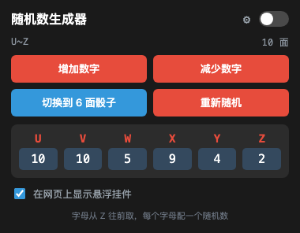
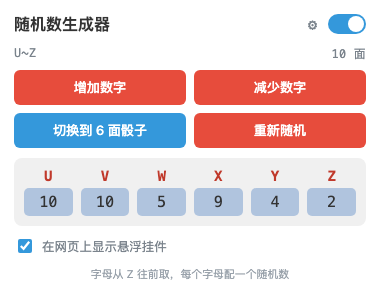
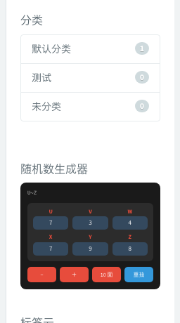
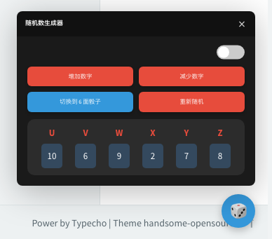
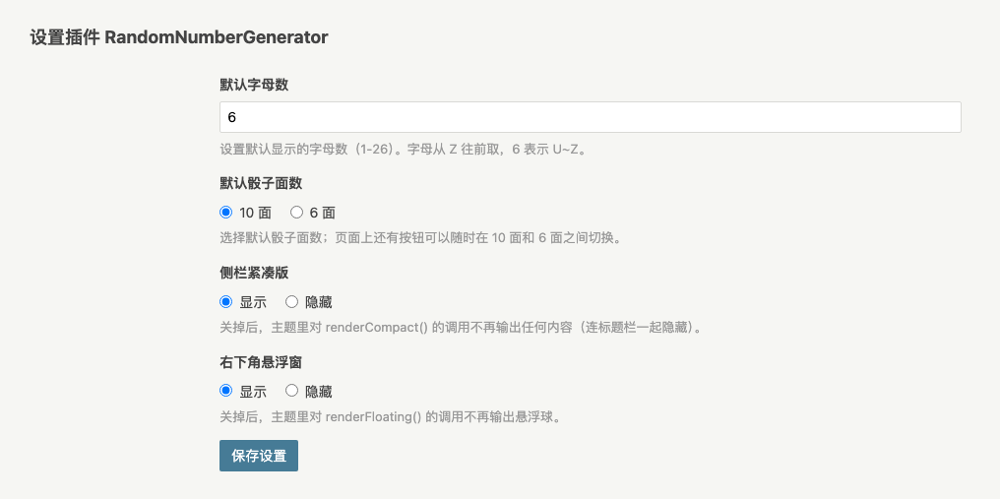
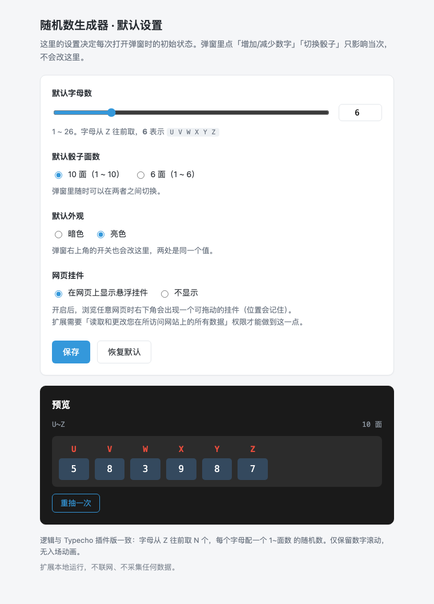
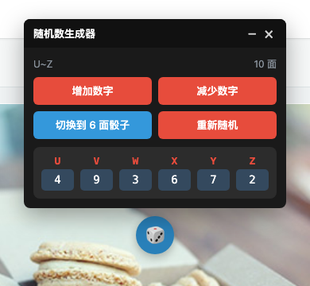

# 随机数生成器

按字母生成随机数的两件套，**逻辑完全一致**：字母从 Z 往前取 N 个（默认 6 → `U V W X Y Z`），
每个字母配一个 `1 ~ 面数` 的随机数，面数支持 **10 面 / 6 面**随时切换。

| | 说明 | 详细文档 |
|---|---|---|
| **插件版** | Typecho 插件。侧栏紧凑版 / 右下角悬浮窗 / 正文短代码 | [RandomNumberGenerator/README.md](RandomNumberGenerator/README.md) |
| **扩展版** | 浏览器扩展（Manifest V3，Edge / Chrome 通用）。点工具栏图标就能用 | [browser-extension/README.md](browser-extension/README.md) |

| 扩展弹窗 · 暗色 | 扩展弹窗 · 亮色 |
|---|---|
|  |  |

---

## 署名与致谢

> ### 原作：[doumiaojiang/RandomNumberGenerator](https://github.com/doumiaojiang/RandomNumberGenerator)
> **原作者：doumiaojiang**　原作版本：`1.1.1`
>
> **原作未声明开源协议**（仓库中没有 LICENSE 文件，GitHub API 的 `license` 字段为 `null`）。
> 按著作权默认规则，**原作的全部权利归原作者 doumiaojiang 所有**。
>
> 本仓库基于原作修改而来，**对自身的修改与新增部分不做版权主张**。
> [LICENSE](LICENSE) **不是开源协议**，只是对版权状态与署名要求的如实陈述；
> 本仓库也没有以自身名义进行任何授权。
>
> **使用时必须保留原作者的署名，这是本项目的唯一要求。**

> ### ⚠️ 使用前请注意
> 原作为**公开仓库**，但**未声明开源协议**，全部权利归原作者 doumiaojiang。
> 本仓库不对原作部分作出任何授权；用于**商业用途**前，建议先联系原作者取得授权。
> 如原作者提出要求，我们会立即下架。

### 署名

| 角色 | 署名 |
|---|---|
| **原作** | [doumiaojiang](https://github.com/doumiaojiang) |
| **维护者** | [lt5d-yunzi](https://github.com/lt5d-yunzi) |
| **代码实现与文档** | **鲸鱼少女**（AI 编码助手 · DeepSeek Harness） |

署名分布在 [LICENSE](LICENSE)、[NOTICE](NOTICE)、
[插件源码头部](RandomNumberGenerator/Plugin.php)（`@original-author` / `@implemented-by`）
以及两个 README，共 5 处。

**感谢 doumiaojiang 的开源分享。**

---

## 一、插件版（Typecho）

### 安装

把 `RandomNumberGenerator/` 整个目录放进 Typecho 的 `usr/plugins/`，到 **后台 → 插件 → 启用**。

> ⚠️ 目录名必须保持 `RandomNumberGenerator`，插件类名前缀与它绑定。

### 三种用法

| 位置 | 怎么开 |
|---|---|
| **正文短代码** | 文章/页面里写 `[random_generator]`，可带参数 `[random_generator letters="8" dice="6"]` |
| **侧栏紧凑版** | 主题 `sidebar.php` 里调用 `RandomNumberGenerator_Plugin::renderCompact(false);` |
| **右下角悬浮窗** | 主题 `footer.php` 里调用 `RandomNumberGenerator_Plugin::renderFloating();` |

悬浮窗**可拖动、可隐藏**：按住小球拖到任意位置（位置记在浏览器本地），
面板标题栏的 `–` 可隐藏挂件并在原位置留一个小圆点召回。

```php
<!-- sidebar.php：放在你想出现的位置 -->
<?php if (class_exists('RandomNumberGenerator_Plugin')): ?>
<section class="widget wrapper-md clear">
  <h3 class="widget-title m-t-none text-md">随机数生成器</h3>
  <?php RandomNumberGenerator_Plugin::renderCompact(false); ?>
</section>
<?php endif; ?>
```

```php
<!-- footer.php：放在 </body> 之前 -->
<?php if (class_exists('RandomNumberGenerator_Plugin')) RandomNumberGenerator_Plugin::renderFloating(); ?>
```

`class_exists` 判断是为了插件被停用时不报错，只是不显示。

| 侧栏紧凑版 | 右下角悬浮窗 |
|---|---|
|  |  |

### 设置

**后台 → 插件 → 随机数生成器 → 设置**：

| 项 | 默认 | 说明 |
|---|---|---|
| **侧栏紧凑版** | 显示 | 显示 / 隐藏（关掉后连标题栏一起不输出） |
| **右下角悬浮窗** | 显示 | 显示 / 隐藏 |
| 默认字母数 | 6 | 1-26 |
| 默认骰子面数 | 10 面 | 10 面 / 6 面 |

两个开关互相独立，正文短代码不受影响。



### 相比原作改了什么

| 类型 | 内容 |
|---|---|
| **新增** | 侧栏紧凑版、右下角悬浮窗、**多实例隔离**、**显示开关**、**悬浮窗可拖动/可隐藏**、短代码参数可省略、默认字母数 4 → 6 |
| **移除** | 入场动画（`rng-scroll` 下落+淡入），只保留数字滚动 |
| **修复** | CSS 死规则（`.rng-scrolling .rng-number` 选择器写反，动画从未生效）、3 处 `error_log` 日志噪音、`letters=0` 的边界规则 |

完整对照见 [插件 README 的「与原作的差异」](RandomNumberGenerator/README.md#与原作的差异)。

**多实例**是必须改的一点：原作交互用全局函数 `addNumber()` 和固定 ID `#result` / `#diceToggle`，
同一页放两个就会互相抢元素。本版改为每个 `.rng-container` 各自持有状态、
交互走 `data-rng-action` 属性、查询限定在自己的 root 内。

---

## 二、扩展版（浏览器）

### 安装（加载解压缩的扩展）

1. Edge 打开 `edge://extensions/`（Chrome 是 `chrome://extensions/`）
2. 打开 **开发人员模式 / 开发者模式**
3. 点 **加载解压缩的扩展 / 加载已解压的扩展程序**
4. 选 `browser-extension/` 目录（含 `manifest.json` 的那一层）

> 不要直接拖 `.crx` 进去 —— Chrome/Edge 会拦截非商店来源的 CRX 安装。
> `dist/RandomNumberGenerator.crx` 可作为构建产物留档。



| 位置 | 说明 |
|---|---|
| 弹窗 | 增加/减少数字、10 面 ↔ 6 面切换、重新随机、日夜开关、**「在网页上显示悬浮挂件」开关** |
| 选项页（右键图标 → 选项） | 默认字母数、默认面数、默认外观、网页挂件开关，带实时预览 |
| **注入到网页的挂件** | 右下角可拖动的小球，位置会记住；可隐藏并召回 |
| 设置存储 | `chrome.storage.sync`（位置存 `local`，按设备） |



---

## 三、代码结构

```
.
├── LICENSE                      版权状态与使用要求（不是开源协议）
├── NOTICE                       署名说明、署名位置、原作者异议处理
├── README.md                    本文件
├── RandomNumberGenerator/       插件版（可直接放进 usr/plugins/）
│   ├── README.md                插件详细文档
│   ├── Plugin.php
│   └── assets/{script.js,style.css}
├── browser-extension/           扩展版
│   ├── README.md
│   ├── manifest.json            MV3 清单
│   ├── rng.js                   纯逻辑：字母生成 / 掷数 / 扩缩
│   ├── storage.js               设置读写（chrome.storage.sync，无 API 时退回 localStorage）
│   ├── popup.{html,css,js}      工具栏弹窗
│   ├── options.{html,css,js}    默认设置页
│   ├── icons/                   16 / 32 / 48 / 128
│   └── tools/make-icons.py      图标生成脚本
├── dist/RandomNumberGenerator.crx
└── screenshots/                各页面截图
```

**为什么扩展版把逻辑单独放一个文件**：`browser-extension/rng.js` 不含任何 DOM 或扩展 API 代码，
所以弹窗和选项页能共用，也能在 Node 里直接 `require` 跑测试：

```js
const RNG = require('./browser-extension/rng.js');
RNG.lettersFor(6);   // ['U','V','W','X','Y','Z']
RNG.lettersFor(1);   // ['Z']
RNG.grow(['U','V']); // ['T','U','V']
RNG.roll(['U','V'], 10); // { U: 7, V: 3 }
```

---

## 四、自己改

**改名/改配色**：插件改 `RandomNumberGenerator/assets/style.css`；
扩展改 `browser-extension/popup.css` 与 `options.css`。

**改图标**（颜色或骰子点数）：

```bash
cd browser-extension && python3 tools/make-icons.py
```

图标是纯 Python（zlib + struct 手写 PNG、4 倍超采样抗锯齿）生成的，不依赖 Pillow / GD。
改脚本顶部的 `BG`（底色）/ `PIP`（点数色）/ `PIPS`（点位）即可。

**改完插件资源务必升版本号**：`RandomNumberGenerator/Plugin.php` 里的 `VERSION` 常量。
资源 URL 带 `?v=<版本>` 做缓存失效，不升版本浏览器会一直用旧文件。

**重新打包 CRX**：

```bash
"/Applications/Microsoft Edge.app/Contents/MacOS/Microsoft Edge" \
  --pack-extension="$PWD/browser-extension"
```

> 想让扩展 ID 保持不变，打包时带上 `--pack-extension-key=<你的.pem>`。
> **`.pem` 是私钥，不要提交到仓库**（`.gitignore` 已排除）。

---

## 五、已知边界

- 插件版在 **Typecho 1.3 + PHP 8** 下验证通过
- 扩展版是 **Manifest V3**，需要较新的 Edge / Chrome（已在 Edge 155 上验证）
- 两者都**不联网、不采集任何数据**
- 插件版的原作**未声明协议**，用于分发或商用前请先联系原作者取得授权
